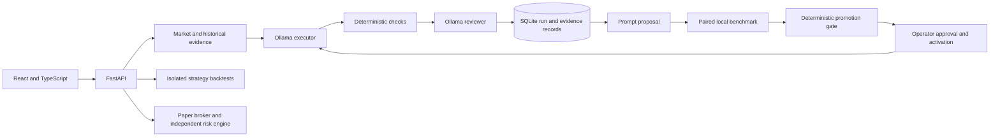

# HIVE — AI-Assisted Intelligence for Smarter Financial Decisions

**Analyze. Evaluate. Evolve.**

HIVE is a local-first application for evaluating AI agents in financial research and paper trading. A configured executor analyzes market evidence. A separate reviewer evaluates the executor’s recorded output. Python checks verify citations, supported numerical claims, and risk constraints independently of model opinions. Prompt changes move through paired benchmarking and explicit operator approval before activation.

## Architecture



The frontend lives in `src`. FastAPI routes live in `backend/app/api/routes`. The LangGraph workflows, Ollama client, objective checks, and benchmark rubric live in `backend/app/review`. SQLite models live in `backend/app/db/models`. Market evidence, the isolated backtest engine, and order settlement have separate modules.

## Start on Windows PowerShell

Use Python 3.11, Node 24, npm, and Ollama. Run these commands from the source checkout.

```powershell
npm.cmd ci
Set-Location backend
python -m venv .venv
.\.venv\Scripts\python.exe -m pip install --upgrade pip setuptools
.\.venv\Scripts\python.exe -m pip install --no-build-isolation -c requirements-windows.lock '.[dev]'
if (-not (Test-Path .env)) { Copy-Item .env.example .env }
```

Set the two model roles in `backend/.env`.

```dotenv
HIVE_EXECUTOR_MODEL=qwen3.5:4b
HIVE_REVIEWER_MODEL=hf.co/unsloth/gemma-3-4b-it-GGUF:Q4_K_M
OLLAMA_BASE_URL=http://localhost:11434
OLLAMA_ENABLED=true
HIVE_MODEL_TIMEOUT_SECONDS=45
HIVE_MODEL_KEEP_ALIVE=0
HIVE_MAX_REVISION_ATTEMPTS=1
```

Start the Ollama desktop app, or run `ollama serve` in a separate terminal if the server is stopped. Install the missing models and check the local inventory.

```powershell
ollama pull qwen3.5:4b
ollama pull hf.co/unsloth/gemma-3-4b-it-GGUF:Q4_K_M
ollama list
Invoke-RestMethod http://localhost:11434/api/tags
```

HIVE checks the installed tags before inference. If Ollama is reachable and a configured tag is missing, Agent Center shows its pull command. The executor and reviewer run sequentially in the API process, with a default keep-alive of zero. Increase the request timeout for slow cold starts. Change role configuration in `.env` and restart the backend. The research workflow records unavailability or failed inference explicitly and preserves any applicable deterministic results.

Run `./start_hive.ps1` from the repository root to start FastAPI and Vite on loopback. Use `./stop_hive.ps1` to stop the application processes recorded by the launcher. Ollama remains available for other local applications. For a manual launch, start FastAPI from `backend`. Startup creates missing tables and seeds local account, instrument, and prompt metadata.

```powershell
.\.venv\Scripts\python.exe -m uvicorn app.main:app --host 127.0.0.1 --port 8000
```

In a second terminal at the repository root, run `npm.cmd run dev -- --host 127.0.0.1` and open http://localhost:5173. Check http://127.0.0.1:8000/api/v1/health and http://127.0.0.1:8000/api/v1/model-status. Stop each server with Ctrl+C. Restart with the same database URL to keep records.

Use a separate SQLite URL for testing or demonstrations. Keep local databases, backups, downloaded provider data, and credentials outside Git. The fresh-install default is `backend/hive.db`.

### Upgrade an existing installation

1. Stop the old application with its existing launcher or console. Locate the SQLite file specified by its `DATABASE_URL` or its earlier default. Keep the source as a rollback copy, along with a private backup of your `.env` file.
2. From the new checkout root, create a verified SQLite snapshot at an unused destination. The command uses SQLite's backup API so committed WAL data is included. It verifies database and foreign-key integrity and refuses to overwrite existing files.

   ```powershell
   backend\.venv\Scripts\python.exe backend/scripts/migrate_database.py $oldDatabasePath backend/hive.db
   ```

   If the source already has foreign-key violations, the command stops. After reviewing them, use `--allow-existing-foreign-key-violations` only if you need an exact copy that preserves those same violations. The command rejects any change in the violation set.

3. Copy configuration values privately. Rename the previous application prefix on `EXECUTOR_MODEL`, `REVIEWER_MODEL`, `MODEL_TIMEOUT_SECONDS`, `MODEL_KEEP_ALIVE`, and `MAX_REVISION_ATTEMPTS` to `HIVE_`. During transition the old keys remain readable with a warning, and the HIVE keys take precedence. Leave `OLLAMA_BASE_URL`, credentials, and provider settings unchanged. Set `DATABASE_URL` to the new snapshot if you chose a custom destination. To continue using your existing SQLite file in place, take a separate backup first and set `DATABASE_URL` explicitly to its path.
4. Start HIVE and check the portfolio, prompt versions, run evidence, and benchmark history before retiring the previous installation. Existing prompt content, evidence bytes, and their hashes remain historical records. The currently approved prompt stays active until a replacement passes the usual benchmark and approval workflow. A clean installation seeds the HIVE-branded prompt. Saved research drafts on the same browser origin carry forward automatically.

The public source snapshot excludes provider archives and historical benchmark reports. To use historical replay or backtesting, register CSV data obtained under terms that allow your use. To reproduce the archive-specific regression checks, place your authorized copies of the original archives in `backend/data/historical`. Those checks compare the original files and cannot be reproduced with substitute data. Raw verification screenshots, model evidence, and databases stay local.

## Use HIVE

| Workflow | What to expect |
| --- | --- |
| Agent Center | Choose an instrument, enter a research task, and run it. The run shows the executor response, independent reviewer findings, deterministic checks, and evidence integrity. A failed executor leaves no generated analysis. An unavailable reviewer leaves an explicit partial run when the executor produced output. |
| Evidence and replay | Verify a run against its own archived packet. Select a date for historical evidence replay and research at end-of-day UTC. Replay uses eligible OHLCV bars and discloses the availability policy and omitted sources. |
| Improvement queue | Generate a draft from observed evaluations. Run the paired benchmark against the persisted baseline and inspect the cases. Approval and activation are separate operator actions. Rollback restores the recorded baseline when its candidate is still active. |
| Market Lab | Inspect quotes and freshness from the configured provider. Provider failures and closed sessions limit actions that require fresh data. The Dhan integration is market-data ingestion. |
| Backtest Studio | Use registered data and strategy settings to produce an isolated strategy backtest. Inspect fees, slippage, trade ledger, equity, and drawdown separately from agent benchmark scores. |
| Paper portfolio | Review simulated holdings, orders, and risk decisions. Immediate and confirmed order paths check price freshness, and the broker applies deterministic rules before settlement. API clients supply a stable `Idempotency-Key` for each manual order submission. |

For proposal authorization, set a private `HIVE_OPERATOR_TOKEN` in `backend/.env` and restart FastAPI. Enter the token and a reason for approvals and version changes in Agent Center. The token also protects risk settings, feed configuration, and portfolio reset. The backend records the local token operator, decision, time, and prompt versions. Run the application on loopback. The token represents a local operator and provides no individual multi-user identity.

Paper risk uses pre-trade equity based on cash and portfolio marks. Defaults are a 10% maximum order, 25% concentration, 10% loss halt relative to initial capital for new buys, 0.1% fee, 0.05% slippage, and integer shares. Large orders may be resized, and an order is rejected if one share exceeds the maximum order value. Sells remain bounded by holdings. HIVE is a paper-trading application with no real-money order routing.

## Evidence and benchmark interpretation

The evidence archive stores the model-visible evidence fields as UTF-8 JSON with sorted keys and compact separators. Verification compares the current archived bytes with the original SHA-256 digest. This establishes consistency relative to the stored digest. Provenance and source accuracy require separate evidence. Historical bars without recorded dissemination timestamps use a documented 16:30 IST availability assumption. Archived macro data and news lacking suitable timestamps are omitted.

The eight-case `hive-standard-v1` suite uses controlled scenario evidence. Baseline and candidate use matching cases, evidence digests, inference settings, and Ollama model digest. Stored artifacts include prompt hashes, structured model outputs, objective checks, errors, per-case scores, and safety and regression results. Eligibility requires complete actual local model trials, a measurable gain, and zero disallowed regressions or candidate safety violations. This single-trial suite is a small demonstration. Historical 7/8 and 8/8 figures remain unverified.

## Development checks

```powershell
npm.cmd run lint
npm.cmd run typecheck
npm.cmd run build
npm.cmd audit --audit-level=high
backend\.venv\Scripts\python.exe -m ruff check --config backend/pyproject.toml backend/app backend/tests backend/scripts
backend\.venv\Scripts\python.exe -m pytest -q backend/tests -m "not local_market_data"
backend\.venv\Scripts\python.exe -m pip check
```

The public test command excludes 14 `local_market_data` tests that require the original archives or a local verification database. Set `HIVE_VERIFICATION_DB` to the latter's path and run the command without `-m` to include the full suite.

The headless Edge smoke test expects local frontend and backend services, the authorized local historical archives described above, and market feeds disabled to exercise the unavailable-data path. Set `HIVE_SMOKE_URL` to the frontend origin and run `npm.cmd run test:browser`. To also exercise live historical research, enable Ollama on the backend and set `HIVE_BROWSER_REAL_MODELS=1` before running the smoke test. Artifacts are written to a new ignored directory under `work`.

HIVE can use a separately configured RAMM-compatible endpoint. The optional local RAMM sidecar was used in engineering verification and is excluded from the public snapshot while its exact upstream revision and license notice are being verified. Paper fills require a fresh provider observation during an open exchange session. A timestamp assigned to a REST response or local cache entry alone cannot authorize settlement.

Automated model failure and lifecycle tests use explicit fixtures. Live model trials and browser verification should be recorded separately. See [engineering verification](docs/IMPLEMENTATION_STATUS.md) for the checked workflows, environment, and limitations.

GitHub withdrew Picomatch advisory `GHSA-fc5q-39xc-vjpf` on November 18, 2026. Both npm audit profiles returned zero findings on November 19 with the same dependency lockfile. The owner-approved exception still covers only trusted local development and builds and deployment of compiled static frontend assets. See the [release security assessment](docs/RELEASE_SECURITY_ASSESSMENT.md) for the dependency paths, constraints, and remediation plan.

## Licensing

HIVE is available as public source. The project owner has yet to select a project-wide open-source license. Third-party dependencies retain their own licenses. See [third-party references and notices](docs/OPEN_SOURCE_REUSE.md).
