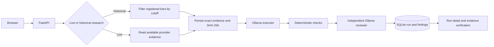
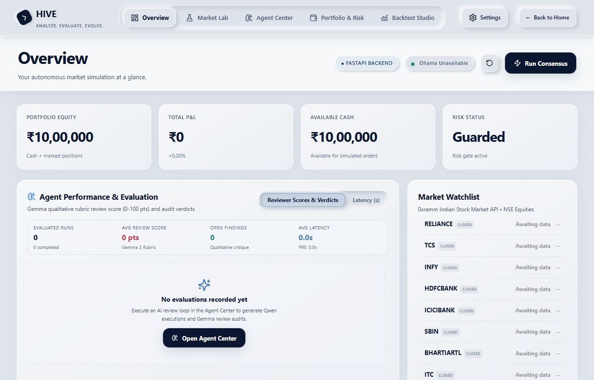
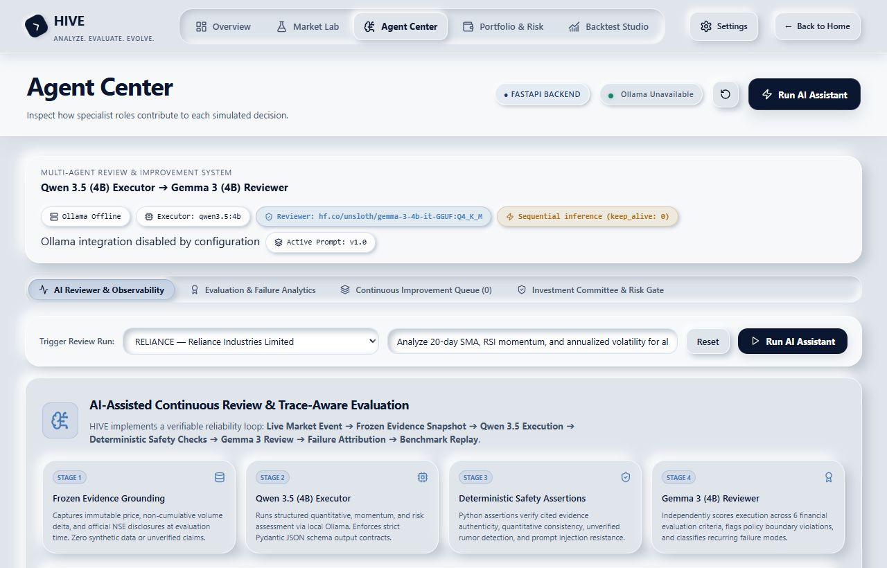
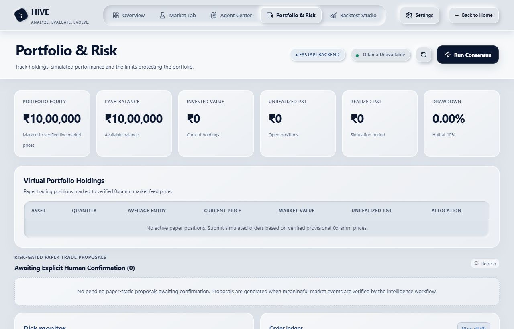
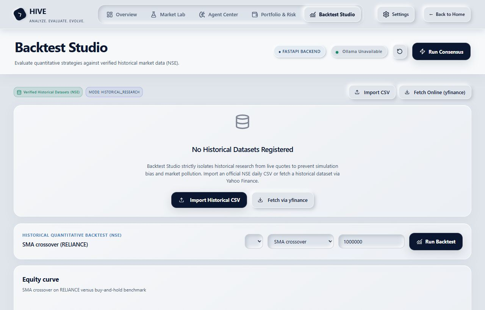

# Demonstrate HIVE

Start from the [README setup](../README.md#start-on-windows-powershell). Confirm that both configured models are installed and that Agent Center reports Ollama online. Use a fresh local SQLite database for a demonstration. Historical workflows require authorized CSV data that you may use locally. The public checkout excludes the historical provider archives and verification databases.

## Walkthrough

1. Open HIVE and select **Launch Simulator**. Check **Overview** for the current runtime status and **Portfolio & Risk** for the starting paper account.
2. Open **Agent Center**. Choose an instrument, ask the executor to cite available price and indicator evidence, and select **Run AI Assistant**. If usable live evidence is unavailable, use the historical replay controls instead. Select a cutoff supported by your registered dataset and choose **Replay at Cutoff**. HIVE applies the selected end-of-day cutoff before constructing the prompt.
3. Select the persisted run. Inspect the execution trace and structured reviewer findings. Open evidence verification to inspect the stored digest, reference checks, and deterministic verdict. An evidence digest verifies the stored bytes against the original run record. Source provenance remains a separate check.
4. Open **Evaluation & Failure Analytics** and inspect the aggregate checks and any recorded failure categories. Open **Continuous Improvement Queue** and choose **Generate Improvement Proposal** when sufficient supporting runs exist. Inspect the cited runs, baseline version, and proposed prompt diff.
5. Select **Run Benchmark Suite** on a draft and compare the baseline and candidate per case. The gate checks paired evidence, measured gain, regressions, and safety failures. An eligible proposal still requires an authorized operator and a recorded reason. Approval and activation are separate actions. The version history supports rollback when the candidate is active.
6. Open **Backtest Studio**, select an authorized dataset, and run a strategy. Compare strategy equity with buy-and-hold and inspect the trade ledger, fees, and slippage. Return to **Portfolio & Risk** to confirm the backtest leaves paper cash and holdings unchanged.

## Recorded promotion-gate example

In a previous live paired trial, both versions passed **8 of 8 cases** and averaged **96.9 points**. The candidate gained 25 points on missing-indicator handling and lost 25 on high-volatility stress. HIVE rejected the candidate on that individual-case regression and kept the baseline active. These are archival results from a controlled suite. A new local trial can produce different scores. [Recorded trial and limitations](IMPLEMENTATION_STATUS.md#linked-proposal-trial)

## Screens from a fresh local session

These screenshots show the running application with a fresh paper account, no imported provider archives, and no prior runs. The recorded trial above comes from a separate private verification environment.

| Overview | Agent Center |
| --- | --- |
|  |  |

| Portfolio and Risk | Backtest Studio |
| --- | --- |
|  |  |
